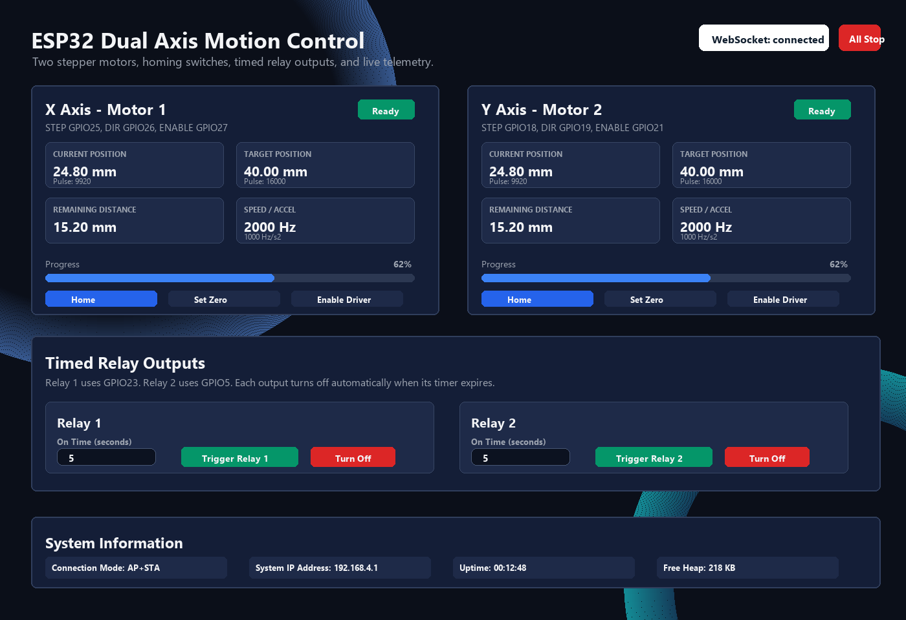

# ESP32 WiFi Dual Axis Stepper Motor Control

ESP32 firmware for controlling two stepper motors with DRV8825 drivers from an embedded WiFi web dashboard. The interface provides live WebSocket telemetry, absolute movement, jog movement, homing, driver enable control, Wi-Fi configuration, and two timed general outputs.



## Main Features

- Two independent stepper axes using FastAccelStepper.
- DRV8825 STEP, DIR, ENABLE, and M0/M1/M2 microstep control.
- Active-low home switch inputs with a two-stage homing routine.
- Software min/max travel limits.
- Position units: pulses, mm, cm, or degrees.
- Wireless control through ESP32 AP mode and optional STA mode on an existing Wi-Fi network.
- WebSocket dashboard telemetry at about 5 Hz.
- Timed Gen.Out1 and Gen.Out2 control from the dashboard.
- NVS storage for motor settings, Wi-Fi credentials, and last known positions.
- Task watchdog enabled in the main loop.

## Hardware Connections

All signal grounds must be common: ESP32 GND, DRV8825 GND, relay module GND, and the control-side power supply ground.

| Function | ESP32 GPIO | Connect To |
| --- | ---: | --- |
| Motor 1 STEP | GPIO25 | DRV8825 Motor 1 STEP |
| Motor 1 DIR | GPIO26 | DRV8825 Motor 1 DIR |
| Motor 1 ENABLE | GPIO27 | DRV8825 Motor 1 ENABLE |
| Motor 1 HOME | GPIO32 | Home switch signal, other switch terminal to GND |
| Motor 1 M0 | GPIO14 | DRV8825 M0 |
| Motor 1 M1 | GPIO13 | DRV8825 M1 |
| Motor 1 M2 | GPIO4 | DRV8825 M2 |
| Motor 2 STEP | GPIO18 | DRV8825 Motor 2 STEP |
| Motor 2 DIR | GPIO19 | DRV8825 Motor 2 DIR |
| Motor 2 ENABLE | GPIO21 | DRV8825 Motor 2 ENABLE |
| Motor 2 HOME | GPIO33 | Home switch signal, other switch terminal to GND |
| Motor 2 M0 | GPIO16 | DRV8825 M0 |
| Motor 2 M1 | GPIO17 | DRV8825 M1 |
| Motor 2 M2 | GPIO22 | DRV8825 M2 |
| Gen.Out1 signal | GPIO23 | Relay module IN1 or transistor driver input |
| Gen.Out2 signal | GPIO5 | Relay module IN2 or transistor driver input |

GPIO5 is usable as a relay output on common ESP32 DevKit boards, but it is also a boot strapping pin. Make sure the relay input does not pull GPIO5 into the wrong state during reset. If your relay board affects boot, change `RELAY2_PIN` in `main/Config.h` to another safe free output pin.

## General Output Behavior

General outputs are defined in `main/Config.h`:

```cpp
#define RELAY1_PIN     23
#define RELAY2_PIN     5
#define RELAY_ACTIVE_HIGH true
```

With the default `RELAY_ACTIVE_HIGH true`, the GPIO goes HIGH while the output timer is active and LOW when the timer expires. For active-low relay modules, set `RELAY_ACTIVE_HIGH` to `false`.

Do not connect relay coils directly to ESP32 GPIO pins. Use a relay module with proper driver circuitry or add a transistor, flyback diode, and a suitable relay supply.

## Web Dashboard

After uploading the firmware, the controller can be reached wirelessly in two ways. In AP mode, the ESP32 creates its own network so a phone, tablet, or computer can connect directly. In STA mode, saved Wi-Fi credentials allow the ESP32 to join an existing router network, so the dashboard can be opened from the ESP32 address assigned by that network.

For direct AP mode access, connect to the ESP32 access point:

- SSID: `ESP32-MOTOR`
- Password: `12345678`
- Browser URL: `http://192.168.4.1`

The Dashboard tab contains:

- Motor 1 and Motor 2 position, target, distance, status, home switch, and driver enable indicators.
- Absolute move controls.
- Jog buttons.
- Home, Set Zero, Enable Driver, and Disable Driver buttons.
- Timed General Outputs for Gen.Out1 and Gen.Out2.
- System information and log output.

To use a general output, enter the on-time in seconds and press `Trigger Gen.Out1` or `Trigger Gen.Out2`. The firmware starts the countdown immediately and turns the output off automatically when the timer reaches zero. The `Turn Off` button cancels the timer manually.

## Sequential Program Tab

The Program tab can run a simple line-by-line text program from the web dashboard. Existing manual motor and general output controls remain available.

Each line contains one command:

```text
VX 5000
VY 5000
X 50
Y 10
D 50
Gen1 ON
D 100
X -50
Gen2 OFF
D 200
Gen1 OFF
```

- `X <value>` moves Motor 1 / X axis by a relative amount.
- `Y <value>` moves Motor 2 / Y axis by a relative amount.
- `VX <steps/s>` changes Motor 1 / X axis runtime speed.
- `VY <steps/s>` changes Motor 2 / Y axis runtime speed.
- `D <milliseconds>` waits before running the next line.
- `Gen1 ON`, `Gen1 OFF`, `Gen2 ON`, and `Gen2 OFF` switch Gen.Out1 and Gen.Out2 directly.
- Empty lines are ignored. Comments can start with `#` or `//`.

Movement values use the currently selected motor unit from Motor Settings: pulse, mm, cm, or degree. The firmware waits for a motor move to finish before it advances to the next line.

## Motor Setup

Use the Motor Settings tab to configure:

- Speed limit in steps per second.
- Acceleration in steps per second squared.
- Software minimum and maximum limits in raw steps.
- Step angle and microstep mode.
- Lead screw pitch, or belt pitch and pulley tooth count.
- Interface unit for the dashboard.
- Driver auto-disable timeout.

Settings are saved to ESP32 NVS and applied immediately.

## Build And Upload

1. Install the ESP32 board package in Arduino IDE.
2. Select an ESP32 Dev Module compatible board profile.
3. Install the required libraries:
   - FastAccelStepper
   - ESPAsyncWebServer
   - AsyncTCP
   - ArduinoJson
4. Open `main/main.ino`.
5. Confirm pin assignments in `main/Config.h`.
6. Compile and upload to the ESP32.

## Documentation

The full wiring and setup guide is available in [walkthrough.pdf](walkthrough.pdf).

## Safety Notes

- Set the DRV8825 current limit before running the motors.
- Test each axis at low speed first.
- Use external protection for relay-controlled AC or high-current loads.
- Do not rely on firmware alone for machine safety. Add hardware emergency stop, fusing, and suitable enclosure practices where required.
