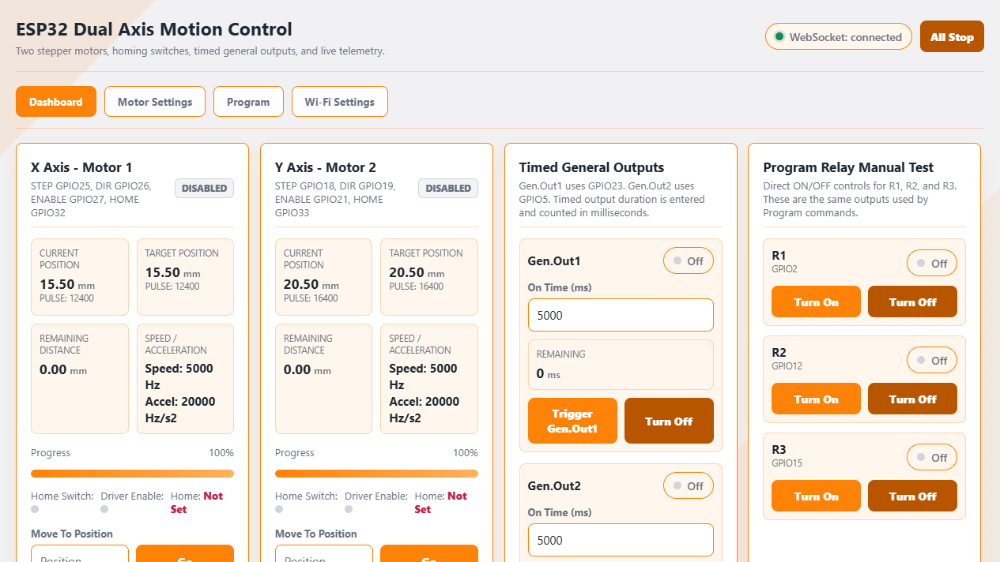
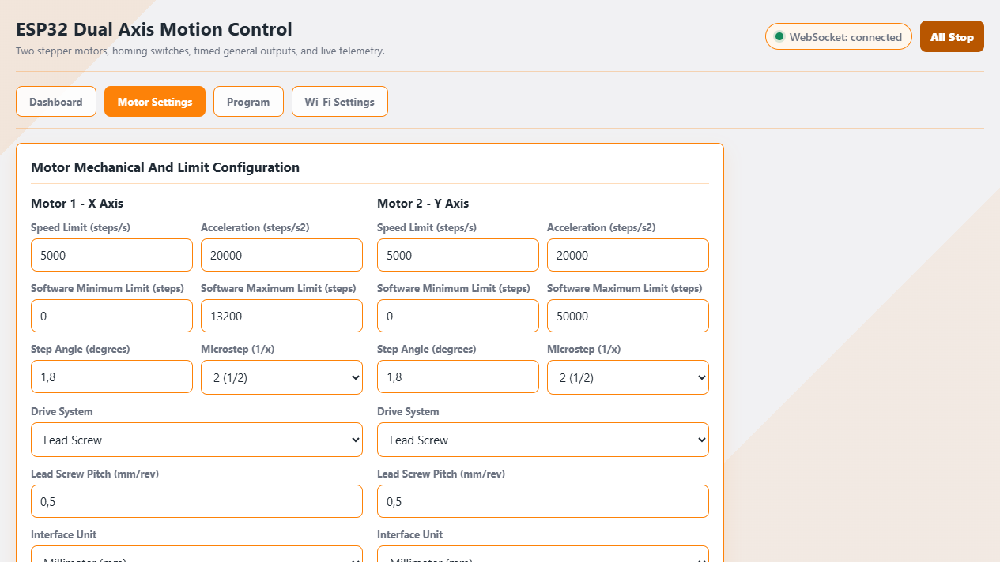
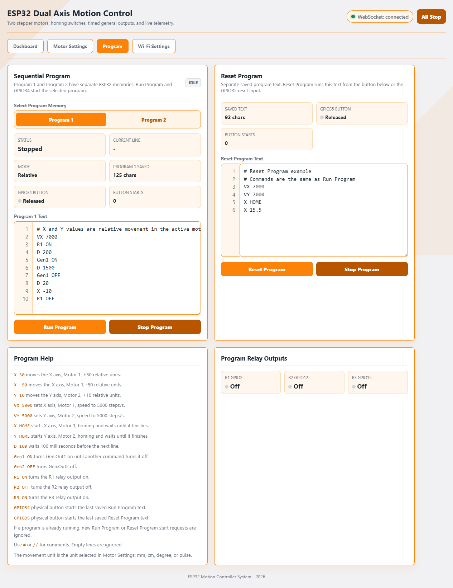

# ESP32 WiFi Dual Axis Stepper Motor Control

ESP32 firmware for controlling two DRV8825 stepper axes from an embedded Wi-Fi web dashboard. The interface includes live WebSocket telemetry, motor setup, homing, timed general outputs, program-controlled relay outputs, two selectable Sequential Program memories, a separate Reset Program editor, and physical start inputs.

## Main Features

- Two independent stepper axes using FastAccelStepper.
- DRV8825 STEP, DIR, ENABLE, and M0/M1/M2 microstep control.
- Active-low home switch inputs with configurable, staged two-pass homing.
- Software min/max travel limits entered in millimeters, with live calculated step values.
- Position units: pulse, mm, cm, or degree.
- ESP32 AP mode plus optional STA mode for an existing Wi-Fi network.
- WebSocket dashboard telemetry at about 5 Hz.
- Timed `Gen.Out1` and `Gen.Out2` controls with millisecond timing.
- Program relay manual test controls for `R1`, `R2`, and `R3`.
- Sequential Run Program editor with separate Program 1 and Program 2 NVS memories.
- Persistent Program 1 / Program 2 selection with line numbers and active-line tracking.
- Separate Reset Program editor using the same command language.
- Physical Run Program button on `GPIO34`.
- Physical Reset Program button on `GPIO35`.
- Orange web theme using `#fd8208`.
- NVS storage for motor settings, Wi-Fi credentials, saved program texts, and last known positions.
- Task watchdog enabled in the main loop.

## Hardware Connections

All signal grounds must be common: ESP32 GND, DRV8825 GND, relay module GND, and the control-side power supply ground.

| Function | ESP32 GPIO | Connect To |
| --- | ---: | --- |
| Motor 1 STEP | GPIO25 | DRV8825 Motor 1 STEP |
| Motor 1 DIR | GPIO26 | DRV8825 Motor 1 DIR |
| Motor 1 ENABLE | GPIO27 | DRV8825 Motor 1 ENABLE |
| Motor 1 HOME | GPIO32 | Home switch signal, other switch terminal to GND |
| Motor 1 M0 | GPIO14 | DRV8825 M0 |
| Motor 1 M1 | GPIO13 | DRV8825 M1 |
| Motor 1 M2 | GPIO4 | DRV8825 M2 |
| Motor 2 STEP | GPIO18 | DRV8825 Motor 2 STEP |
| Motor 2 DIR | GPIO19 | DRV8825 Motor 2 DIR |
| Motor 2 ENABLE | GPIO21 | DRV8825 Motor 2 ENABLE |
| Motor 2 HOME | GPIO33 | Home switch signal, other switch terminal to GND |
| Motor 2 M0 | GPIO16 | DRV8825 M0 |
| Motor 2 M1 | GPIO17 | DRV8825 M1 |
| Motor 2 M2 | GPIO22 | DRV8825 M2 |
| Gen.Out1 signal | GPIO23 | Relay module input or transistor driver input |
| Gen.Out2 signal | GPIO5 | Relay module input or transistor driver input |
| R1 relay signal | GPIO2 | Relay module input or transistor driver input |
| R2 relay signal | GPIO12 | Relay module input or transistor driver input |
| R3 relay signal | GPIO15 | Relay module input or transistor driver input |
| Run Program button | GPIO34 | Momentary button to GND with external 10k pull-up to 3.3V |
| Reset Program button | GPIO35 | Momentary button to GND with external 10k pull-up to 3.3V |

`GPIO34` and `GPIO35` are input-only and do not have internal pull-up or pull-down resistors. Use an external `10k` pull-up to `3.3V`, and wire each button between its GPIO and GND.

`GPIO5`, `GPIO2`, `GPIO12`, and `GPIO15` are boot strapping pins on many ESP32 DevKit boards. If a relay board pulls one of these pins into an unsafe boot state, change the related pin in `main/Config.h` or add suitable external biasing/driver circuitry.

## Output Behavior

General outputs are defined in `main/Config.h`:

```cpp
#define RELAY1_PIN     23
#define RELAY2_PIN     5
#define RELAY_ACTIVE_HIGH true
#define PROGRAM_RELAY1_PIN 2
#define PROGRAM_RELAY2_PIN 12
#define PROGRAM_RELAY3_PIN 15
#define PROGRAM_START_BUTTON_PIN 34
#define RESET_PROGRAM_BUTTON_PIN 35
```

With `RELAY_ACTIVE_HIGH true`, outputs are ON when the GPIO is HIGH and OFF when LOW. For active-low relay modules, set `RELAY_ACTIVE_HIGH` to `false`.

The firmware now drives `Gen.Out1` and `Gen.Out2` to the inactive level as early as possible during `setup()`, and each `RelayController` preloads the inactive output latch before enabling the GPIO as an output. This reduces firmware-controlled startup pulses. If `GPIO5` still pulses before firmware starts, that is caused by ESP32 boot/strapping behavior and must be solved with hardware biasing, a transistor driver, or a different GPIO.

Do not connect relay coils directly to ESP32 GPIO pins. Use relay modules with proper driver circuitry, or add a transistor, flyback diode, and suitable relay supply.

## Web Dashboard

For direct AP mode access:

- SSID: `ESP32-MOTOR`
- Password: `12345678`
- Browser URL: `http://192.168.4.1`

If STA credentials are saved in Wi-Fi Settings, the ESP32 also joins the configured router network. Open the dashboard using the router-assigned ESP32 IP address.

Dashboard tab - current live control layout:

- Motor position, target, distance, progress, status, home switch, and driver enable telemetry.
- Absolute move controls plus independent `0.1`, `1`, and `10` manual jog-step selectors for the X and Y axes.
- Rapid same-direction jog commands accumulate against a bounded target and cannot queue motion beyond the configured software limit.
- An opposite jog replaces the active movement queue immediately, so direction changes do not wait for the previous target or driver auto-disable timeout.
- When a home switch is active, negative movement toward that switch is rejected; an in-progress negative move is stopped immediately, while positive movement away from the switch remains available.
- Home, Set Zero, Enable Driver, and Disable Driver buttons.
- Timed `Gen.Out1` and `Gen.Out2` controls.
- Dashboard manual ON/OFF tests for `R1`, `R2`, and `R3`.
- System information and console log.

Timed `Gen.Out1` and `Gen.Out2` durations are entered and counted in milliseconds. The default value is `5000 ms`, and the maximum is `86400000 ms` (24 hours).

## Interface Screenshots

The screenshots below are retained for reference and will be refreshed separately. The feature descriptions in this README reflect the current firmware.

Dashboard tab:



Motor Settings tab - current mechanical and limit configuration layout:



Program tab - Program 1 / Program 2 selection and Reset Program:



## Program Tab

The Program tab has one Sequential Program editor with two selectable memories, plus a separate Reset Program editor:

- `Program 1`: first Sequential Program memory, stored under `program_text`.
- `Program 2`: second Sequential Program memory, stored under `program_2`.
- `Reset Program`: runs from the `Reset Program` button or the physical `GPIO35` button.

All three memories use the same command language and are saved separately in ESP32 NVS. The selected Sequential Program slot is stored under `program_sel`. `Run Program` and the physical `GPIO34` button start whichever Sequential Program is selected. The selection is restored after restart, and a newly opened browser reads Program 1, Program 2, Reset Program, and the selected slot from ESP32 memory.

The Reset Program text remains independent under the `reset_prog` key. When ESP32 memory contains a saved Reset Program, that device copy takes priority over stale browser-local data.

If a program is already running, new Run Program or Reset Program start requests are ignored. The firmware waits until each motor has both stopped and reached its accepted target before advancing to the next line. A completed homing cycle synchronizes the physical coordinate and internal target to zero, so the first relative command after `X HOME` or `Y HOME` starts from a deterministic zero position.

Example:

```text
VX 5000
VY 5000
X 50
Y 10
D 50
Gen1 ON
R1 ON
D 100
X -50
Gen2 OFF
R2 ON
D 200
R1 OFF
R2 OFF
R3 ON
D 100
R3 OFF
Gen1 OFF
```

Commands:

- `X <value>` moves Motor 1 / X axis by a relative amount.
- `Y <value>` moves Motor 2 / Y axis by a relative amount.
- `VX <steps/s>` changes Motor 1 / X axis runtime speed.
- `VY <steps/s>` changes Motor 2 / Y axis runtime speed.
- `X HOME` starts Motor 1 / X axis homing and waits until it finishes.
- `Y HOME` starts Motor 2 / Y axis homing and waits until it finishes.
- `D <milliseconds>` or `WAIT <milliseconds>` waits before running the next line.
- `Gen1 ON`, `Gen1 OFF`, `Gen2 ON`, and `Gen2 OFF` switch Gen.Out1 and Gen.Out2 directly.
- `R1 ON`, `R1 OFF`, `R2 ON`, `R2 OFF`, `R3 ON`, and `R3 OFF` switch program relay outputs.
- Empty lines are ignored.
- Comments can start with `#` or `//`.

Movement values use the unit selected in Motor Settings: pulse, mm, cm, or degree.

Homing uses an independent staged speed profile. `VX` and `VY` affect normal/program movement only; they do not change the configured homing speeds or acceleration.

## Motor Settings

Use the Motor Settings tab to configure:

- Speed limit in steps per second.
- Acceleration in steps per second squared.
- Software minimum and maximum limits entered in millimeters. The dashboard shows the calculated step value and `steps/mm` conversion for reference.
- Step angle and microstep mode.
- Lead screw pitch, or belt pitch and pulley tooth count.
- Interface unit for the dashboard and program movement values.
- Independent homing settings for fast-search speed, slow-approach speed, homing acceleration, extra switch clearance, maximum switch-release travel, direction-settle delay, switch debounce, and search timeout.
- Driver auto-disable timeout.

Settings are saved to ESP32 NVS and applied immediately. Homing speeds and distances use the selected interface unit and are converted to steps at runtime, keeping the physical homing behavior consistent when the microstep setting changes.

## Build And Upload

1. Install the ESP32 board package in Arduino IDE or Arduino CLI.
2. Select an ESP32 Dev Module compatible board profile.
3. Install the required libraries:
   - FastAccelStepper
   - ESPAsyncWebServer
   - AsyncTCP
   - ArduinoJson
4. Open `main/main.ino`.
5. Confirm pin assignments in `main/Config.h`.
6. Compile and upload to the ESP32.

Example Arduino CLI commands:

```powershell
arduino-cli compile --fqbn esp32:esp32:esp32 main
arduino-cli upload -p <PORT> --fqbn esp32:esp32:esp32 main
```

## Documentation

The current wiring and setup guide is available in [walkthrough.pdf](walkthrough.pdf).

## Versioning Notes

Local full-project snapshots are kept under `legacy/` before larger changes. The `legacy/` folder is intentionally ignored by Git and should not be pushed to GitHub.

## Safety Notes

- Set the DRV8825 current limit before running the motors.
- Test each axis at low speed first.
- Use external protection for relay-controlled AC or high-current loads.
- Do not rely on firmware alone for machine safety. Add hardware emergency stop, fusing, and suitable enclosure practices where required.
